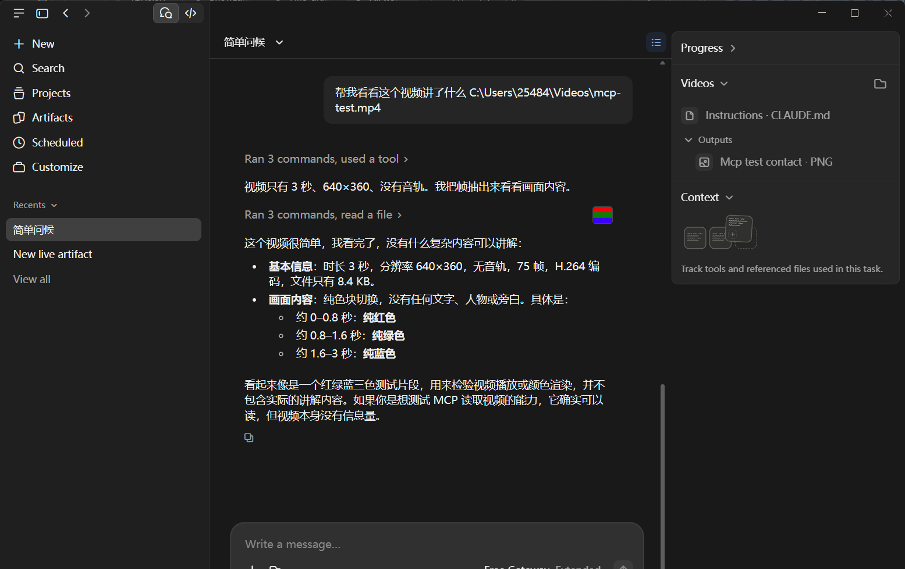

# mcp-video-learn

<p>
  <a href="https://www.npmjs.com/package/mcp-video-learn"></a>
  
  
  
</p>

**English** · [中文文档](#中文文档)

> **Give your model eyes for video.** A local MCP server that turns a video (or a GIF) into a
> scene-aware contact sheet plus subtitles — so the model can actually *see* what happens,
> instead of reading a title and guessing.
>
> **No IM gateway required.** Input is a file path, a media URL, or a Bilibili link.
> Works with Claude Desktop, DSH, Cursor — any MCP client that renders images.

---

## Why it exists

Models can't watch videos. Feed one a link and it usually gets a page title; feed it a GIF and
it sees a filename. This server does the boring part properly:

- **Scene-change sampling**, not "9 evenly spaced frames" — a red→green cut is caught even though
  the luma barely changes (ffmpeg's `select=gt(scene,…)` only compares luma, so it misses it).
- **Tiled contact sheets** — 3×3 grids the model can read in one glance, chunked for long videos.
- **Subtitles when available** — the picture shows *what*, the transcript shows *why*.

## Install

```bash
# 1. ffmpeg must be on PATH (or set VIDEO_FFMPEG)
ffmpeg -version

# 2. clone & install
git clone https://github.com/hoholi-668/mcp-video-learn.git
cd mcp-video-learn
npm install --omit=optional   # sharp is optional (WebP/AVIF only)

# 3. smoke test
node src/index.js             # prints "ready" then waits on stdio
```

```bash
npx -y mcp-video-learn
```

or install globally / point your MCP client at the `bin` above.


## Connect it

### Claude Desktop

`claude_desktop_config.json`:

```json
{
  "mcpServers": {
    "video-learn": {
      "command": "node",
      "args": ["/absolute/path/mcp-video-learn/src/index.js"],
      "env": {
        "VIDEO_ALLOW_ROOTS": "/Users/me/Videos:/Users/me/Desktop",
        "VIDEO_FFMPEG": "/opt/homebrew/bin/ffmpeg"
      }
    }
  }
}
```

Windows: use absolute paths with escaped backslashes and `;` between roots.

### DSH

```yaml
- id: mcp-video-learn
  name: '@deepseek-ai/dsh-mcp-client'
  config:
    serverName: video-learn
    transport: stdio
    command: node
    args: ['/absolute/path/mcp-video-learn/src/index.js']
```

Step-by-step walkthrough: [docs/quickstart-dsh.md](docs/quickstart-dsh.md).

## Tools

| Tool | What it does |
|---|---|
| `media_frames` | Video / GIF / local file / URL → tiled contact sheet(s) |
| `bili_video_watch` | Bilibili link → grid + subtitles (official API, works from datacenter IPs) |
| `bili_video_info` | Title / uploader / duration / subtitle availability — decide before watching |
| `bili_search` | Search by title when you only have a name |

## Configuration

| Env var | Default | Meaning |
|---|---|---|
| `VIDEO_ALLOW_ROOTS` | temp dirs only | `:` (Linux/macOS) or `;` (Windows) separated roots allowed for local files |
| `VIDEO_FFMPEG` | `ffmpeg` | ffmpeg executable |
| `VIDEO_FFPROBE` | derived from ffmpeg | ffprobe executable (needed on Windows when ffprobe ships with different DLLs) |
| `BILI_COOKIES` | — | Netscape cookie file for Bilibili |
| `BILI_COOKIE` | — | raw cookie header instead of a file |
| `SHARP_MODULE` | bundled | path to a `sharp` module for WebP/AVIF |

## Verified

| What | Where | Result |
|---|---|---|
| Unit tests | Node 20 / 22 / 24 | 25 passing |
| Real media matrix (68 cases) | Linux + **Windows** (GitHub Actions) | all passing |
| Claude Desktop | Windows 11, 2026-11-11 | video described correctly from the grid |
| Cline (VS Code) | Windows 11, 2026-11-11 | tool call works; images arrive as base64 text on OpenAI-compatible providers (Cline-side limitation) |
| Cursor | — | not tested yet (standard stdio) |



## Known limits

- No audio transcription — subtitles only when the platform provides them.
- ffmpeg 4.4+ (older builds may lack `tblend`/`signalstats`).
- Bilibili occasionally risk-controls datacenter IPs; the server falls back between API and yt-dlp.
- Local files must be under `VIDEO_ALLOW_ROOTS`.

## FAQ

**Does it cost a lot of tokens?**
Frames are rendered locally; one call returns 1–6 images. Token cost is roughly "how many images you ask for", not video length.

**What about long videos?**
Default is 9 frames. Use `chunks: 1–6` to get one grid per segment instead of squashing everything into one sheet.

**Why not ffmpeg's `select=gt(scene,…)`?**
It only compares luma. A red→green cut has almost identical luma, so it is missed. This project uses `tblend` + `signalstats` (Y/U/V max) instead.

**Bilibili returns 412?**
Datacenter IPs get risk-controlled. The server uses the official API first and falls back to yt-dlp; a cookie file (`BILI_COOKIES`) improves success rate.

**The client shows no image?**
The client must support MCP image content. Plain CLI clients usually drop images.

**Windows has no ffmpeg?**
Set `VIDEO_FFMPEG` (and `VIDEO_FFPROBE` if ffprobe ships with different DLLs).

## License

MIT

---

# 中文文档

### 这套插件

| 插件 | 作用 | 依赖 |
|---|---|---|
| [mcp-video-learn](https://github.com/hoholi-668/mcp-video-learn) | 视频 / 动图 → 九宫格 + 字幕 | ffmpeg |
| [mcp-roster](https://github.com/hoholi-668/mcp-roster) | 人物名册与权限（默认拒绝） | 无 |
| [conversation-pacing](https://github.com/hoholi-668/conversation-pacing) | 群聊发言节奏：什么时候说、说给谁 | 无 |
| [dsh-qq-persona](https://github.com/hoholi-668/dsh-qq-persona) | 「不像客服」的人格模板 | 无 |
| [mcp-qzone-safe](https://github.com/hoholi-668/mcp-qzone-safe) | QQ 空间操作（**需要 OneBot 网关，存量环境**） | OneBot 网关 |

> 除 qzone 外，其余插件都不依赖任何 IM 网关——任何 MCP 客户端（DSH / Claude / Cursor）都能直接接。

### 它解决什么问题

| 痛点 | 主流做法 | 这里的做法 |
|---|---|---|
| 视频太长，模型看不完 | 按时长均匀切 9 帧 | **先找画面变化点，再在变化点里取 9 帧** |
| 10 分钟视频只有一张图 | 一张九宫格概括全部 | **`chunks=N` 分段，每段一张九宫格** |
| 视频里的对话听不到 | 只看画面 | **同时抓字幕文本** |
| 机房 IP 抓 B 站被 412 | 依赖 yt-dlp 抓网页 | **走官方 API，不抓网页** |
| 动图 WebP 只出第一帧 | 放弃 | **sharp 逐帧解码** |

---

> **第一次接 DSH？** 看 [10 分钟接入指南](docs/quickstart-dsh.md)——从零到看见视频。

### 30 秒上手

```bash
# 1. 依赖：ffmpeg 必须在 PATH 里
ffmpeg -version

# 2. 拉代码（本项目未发布 npm）
git clone https://github.com/hoholi-668/mcp-video-learn.git
cd mcp-video-learn
npm install --omit=optional     # sharp 可选，不装也能用其它格式

# 3. 试跑：出现 ready 就说明能启动
node src/index.js
```

接进 MCP 客户端（以 DSH 为例）：

```yaml
- id: mcp-video-learn
  name: '@deepseek-ai/dsh-mcp-client'
  config:
    serverName: video-learn
    transport: stdio
    command: node
    args: ['/绝对路径/mcp-video-learn/src/index.js']
    env:
      VIDEO_FFMPEG: /usr/bin/ffmpeg
      VIDEO_ALLOW_ROOTS: /data/clips:/tmp
      # 可选：B 站登录态（更高码率 / 受限视频）
      BILI_COOKIES: /path/to/bili-cookies.txt
```

> 其它客户端（Claude Desktop / Cursor / Cline）同理：`command` 指向 node，`args` 指向 `src/index.js` 的**绝对路径**。
> 注意：客户端要支持 image content，否则你只能看到元信息、看不到图。

**装好之后不用记工具名**，直接说人话：

```
这个视频讲了什么 https://www.bilibili.com/video/BVxxxxxxx
帮我看看这个文件是什么 D:\clips\demo.mp4
这个动图里是什么 C:\stickers\blink.webp
```

---

### 四个工具

| 工具 | 做什么 | 输入 |
|---|---|---|
| `bili_search` | 按标题搜 B 站，返回 bvid / UP / 时长 | 关键词 |
| `bili_video_info` | 只看元信息，不下载（判断值不值得看） | B 站链接 |
| `bili_video_watch` | 看 B 站视频：下载 → 抽帧 → 字幕；可 `chunks=N` | B 站链接 |
| `media_frames` | 看**任意**动的东西：本地文件 / 直链 / B 站；可 `chunks=N` | 路径、URL、链接 |

**怎么选**：

```
只想知道是什么     → bili_video_info
想看内容           → bili_video_watch
只有标题没有链接   → bili_search 拿到 bvid，再 bili_video_watch
本地视频 / GIF     → media_frames
长视频想分段看     → 任意一个工具加 chunks=3~6
```

---

### 核心机制（这是它和"均匀切 9 帧"的区别）

#### 1. 场景变化检测：不用 ffmpeg 自带的 `select=scene`

ffmpeg 的 `select=gt(scene,…)` **只比较亮度**。实测：红→绿这种「亮度几乎不变、色相差很多」的切换，
3 段纯色视频只抓到 1 个切点。

这里的做法是逐帧差分：

```
tblend 求相邻帧差 → signalstats 给出 Y/U/V 均值 → 取三者最大
实测：红→绿 V=159，绿→蓝 U=149（都抓到了）
```

为了让 5 分钟素材也能秒级跑完，先降采样：

```
fps=5, scale=160 → 实测 12 秒降到 2 秒
0.2 秒内的相邻峰合并成一个切点
```

#### 2. FIFO 队列：只收"画面真的变了"的帧

```
画面进来 → 变化分够高才入队 → 队满淘汰最旧 → 最终快照就是网格内容
```

两种取用方式：

| 策略 | 取什么 | 适合回答 |
|---|---|---|
| `overview`（默认） | 变化点里**均匀摊开** N 个 | "这视频讲了什么" |
| `recent` | **队列最终快照**（最近 N 个变化） | "现在在干嘛 / 结尾发生了什么" |

**队满之后怎么筛**：用**队内中位数**做相对门槛——新变化点必须不弱于队里一半以上的帧。
不用固定绝对阈值，是因为夜景/雪景/幻灯片的差分基线差别极大，写死一个数要么全收要么全拒。

拿不到变化点时（纯色、极短片段）自动退回均匀采样，返回文本会标明 `mode=scene` / `mode=uniform`。

#### 3. 分段九宫格：长视频一次给多段

单张图只覆盖 9 个瞬间。10 分钟视频里大部分内容根本没被看到。

```
media_frames("D:/clips/lecture.mp4", frames=9, chunks=3)

返回：
  分段：3 段，每段 9 帧，共 27 帧
  [第 1 段 0:00-3:20]（场景变化，命中 12 个变化点）
  <九宫格 1>
  [第 2 段 3:20-6:40]（场景变化，命中 9 个变化点）
  <九宫格 2>
  [第 3 段 6:40-10:00]（段内均匀采样）
  <九宫格 3>
```

**为什么不让她一段一段调工具**：每调一次工具，整段上下文都要重发一遍。
一次给 3 张，token 约为分 3 次的 1/3，而且不会出现「看到一半跑去收尾」。

| 参数 | 默认 | 说明 |
|---|---|---|
| `chunks` | 1 | 分几段（1~6）；每段至少 1.5 秒，太短会自动减段 |
| `frames` | 9 | **每段**几帧（1~12） |
| `tileWidth` | 400 | 每帧宽度；**会自动钳到源视频宽度**，小视频不放大 |

#### 4. 字幕：补上画面之外的信息

B 站视频会走 API 拿字幕列表并下载，转成纯文本附在结果里。
**九宫格听不到台词，字幕能。**

#### 5. 只有标题没有链接？搜

QQ/微信分享视频经常只来一张小程序卡片——只有标题和封面，没有地址
（`m.q.qq.com/a/s/...` 是小程序协议，抓不到 bvid）。

```
用户：这个视频讲了什么（卡片标题「这个画面我幻想了无数次」）
你：  bili_search(keyword="这个画面我幻想了无数次")
     → BV1X9446NEMz / 落叶也会下雨 / 1:01
     bili_video_watch("https://www.bilibili.com/video/BV1X9446NEMz")
```

结果有多条同名视频时，先报标题/UP/时长让用户确认。

---

### 支持哪些格式

| 格式 | 能不能看 | 需要额外装东西吗 |
|---|---|---|
| 视频 `.mp4` `.mkv` `.webm` `.mov` `.flv` | ✅ | 不需要 |
| GIF `.gif` | ✅ | 不需要 |
| 静态图 `.png` `.jpg` `.webp`（单帧） | ✅ | 不需要 |
| 动图 WebP `.webp`（多帧） | ⚠️ | **需要 `sharp`**（或 ffmpeg 6.x） |

**GIF 和视频开箱即用；只有动图 WebP 需要额外装 sharp。**

```bash
npm i sharp
# 或者复用宿主里已装的：
export SHARP_MODULE=/path/to/node_modules/sharp
```

没装 sharp 时，动图 WebP 会**明确告诉你缺什么**，而不是给你一张黑图。

---

### B 站：走官方 API，机房 IP 也能用

云服务器抓 `www.bilibili.com` 会被 **412** 拦（cookie 也救不了，拦的是网页请求）。所以这里不抓网页：

```
view 接口   → 标题 / UP 主 / 时长 / cid
wbi 签名    → playurl 拿视频流地址
player/v2   → 字幕列表 → 下载字幕 JSON
直接下流    → ffmpeg 抽帧拼网格
```

`buvid3` 会自动向 `/x/frontend/finger/spi` 申请，**不登录也能取元信息**。

**需要更高码率 / 受限视频时**，配一个小号 cookie（务必小号）：

```bash
export BILI_COOKIES=/root/bili-cookies.txt          # Netscape 格式
# 或一行 cookie 串：
export BILI_COOKIE="$(node scripts/cookies-to-env.mjs /root/bili-cookies.txt)"
```

> cookie 等于登录态：不要提交 git、不要发聊天里。没有 cookie 时多数视频仍可下（约 480p）。

下载顺序是 **API → 重试一次 → yt-dlp 兜底**。两条都失败时错误会分开列：

```
B 站下载失败。
API（试了 2 次）：<原因>
yt-dlp：HTTP Error 412（412 = 网页风控；API 正常时不需要访问网页）
```

---

### 配置项

全部走环境变量，没有配置文件：

| 变量 | 默认 | 说明 |
|---|---|---|
| `VIDEO_FFMPEG` | `ffmpeg` | ffmpeg 可执行文件 |
| `VIDEO_YTDLP` | `yt-dlp` | 仅 B 站 API 失败时兜底 |
| `BILI_COOKIES` | — | B 站 cookies.txt（Netscape 格式） |
| `BILI_COOKIE` | — | B 站 cookie 串 |
| `VIDEO_COOKIES` | — | 兼容旧名，等同 `BILI_COOKIES` |
| `VIDEO_AUDIT` | `~/.cache/mcp-video-learn/audit.jsonl` | 审计日志 |
| `VIDEO_MAX_MB` | `60` | 单次下载体积上限 |
| `VIDEO_ALLOW_ROOTS` | 当前目录 + 临时目录 | 允许读取的本地目录（路径分隔符分隔） |
| `SHARP_MODULE` | — | 复用宿主已装的 sharp |
| `XDG_CACHE_HOME` | `~/.cache` | 审计日志默认目录的上级 |
| `XDG_CONFIG_HOME` | `~/.config` | 默认 cookies 路径的上级 |

---

### 安全边界

| 措施 | 目的 |
|---|---|
| 本地路径白名单 `VIDEO_ALLOW_ROOTS` | 防止变成任意文件读取器 |
| 直链只认媒体扩展名 | 防止变成通用下载器 |
| 体积上限 `VIDEO_MAX_MB` | 防止磁盘/带宽被打满 |
| 每步超时 | 防止卡死 |
| 只接受 `bilibili.com` / `b23.tv` | 链接白名单 |
| 本地审计日志 | 每次调用留痕 |

---

### 实测数据

**在 Claude Desktop 里实测（2026-11-11）**：装好 MCP 后让它看一段 3 秒测试视频，
它准确报出「0~0.8s 红、0.8~1.6s 绿、1.6~3s 蓝」——说明九宫格真的进了模型的眼睛。


| 层 | 命令 | 覆盖 | 结果 |
|---|---|---|---|
| 单元 | `npm test` | 队列语义、分段规划、URL 校验、网格计算 | **25/25** |
| 真实媒体矩阵 | `npm run selftest:matrix` | mp4/gif/webp/png、1s~40s、横竖屏、frames 1~12、tileWidth 64~640、坏文件、白名单 | **68/68** |
| MCP 协议 | `npm run selftest:mcp` | 真实拉起服务、列工具、调工具、拒非法输入、真实 B 站 watch | **8/8** |
| 跨平台 | GitHub Actions | ubuntu-latest × Node 20/22 + **windows-latest** × Node 22 | **全部通过** |

**性能（服务器实测）**：5 分钟 640×360 视频，场景检测 **3.1 秒**，出图 **9.2 秒**。
**B 站真实视频**：3 分 33 秒 MV，下载 10 MB / 10.5 秒，9 帧网格 + 522 字字幕。

---

### 踩坑记录（写给后来的人）

| 现象 | 根因 | 修法 |
|---|---|---|
| `Unrecognized option 'fps_mode'` | ffmpeg 4.4 没有该参数 | 自动探测版本，4.x 用 `-vsync vfr` |
| 红→绿切换抓不到 | `select=gt(scene,…)` 只比亮度 | 改 `tblend` + `signalstats` 取 Y/U/V 最大值 |
| 一张图都出不来 | `tile` 必须凑满 cols×rows | 变化点不足时补均匀时间点 |
| 机房 IP 抓 B 站 412 | 网页风控 | 元信息与下载全走官方 API + `buvid3` |
| 动图 WebP 只出第一帧 | ffmpeg 4.4 解码器只认静态 WebP | sharp 兜底；坏文件识破并报错 |
| 测的和跑的不是同一份代码 | 同功能两份实现 | 统一到 `src/pipeline.js` |
| 小视频被放大糊掉 | 默认 tile 400 大于源宽 | tile 自动钳到源宽 |
| 矩阵断言突然失败 | 改了 tile 行为没同步断言 | 断言改用同一口径（已固化进 CI） |

---

### 兼容范围

| 项 | 要求 | 实测情况 |
|---|---|---|
| 操作系统 | Linux / Windows / macOS | Linux ✅ 全测；Windows ✅ **CI 实测（媒体矩阵 68 项通过）**；macOS ⬜ |
| Node.js | `>= 20` | 20 / 22 / 24；CI 覆盖 20、22 |
| ffmpeg | `>= 4.4` | 4.4.2 与最新版都通过（自动适配 `-fps_mode` / `-vsync`） |
| yt-dlp | 可选 | 只有 B 站 API 失败才用 |
| sharp | 可选 | 只有动图 WebP 需要 |

**AI 客户端**：

| 客户端 | 状态 |
|---|---|
| DSH 0.1.x / 0.2.x | ✅ 实测 |
| **Claude Desktop** | ✅ **实测（2026-11-11，Windows）**：能看图并准确复述画面变化，见下方截图 |
| **Cline（VS Code）** | ✅ **工具调用实测（2026-11-11）**：media_frames 被正确调用；🟡 OpenAI 兼容通道下图片会被转成 base64 文本，模型看不到画面（Cline 侧限制） |
| Cursor | 🟡 未实测（走标准 stdio，预期与 Claude Desktop 一致） |
| 纯 CLI 客户端 | 🟡 能调工具，但**图片可能被丢弃** |


**平台注意**：Windows 下 `VIDEO_ALLOW_ROOTS` 用**分号**分隔；`VIDEO_FFMPEG` 可指绝对路径（兼容 `ffmpeg.exe`）。

---

### 自测与开发

```bash
node --test                                # 单测 25 项
node scripts/selftest-matrix.mjs /tmp/m    # 真实媒体矩阵 68 项（需要 ffmpeg）
node scripts/selftest-mcp.mjs              # MCP 协议层 8 项
```

```
src/index.js       工具注册与参数校验
src/pipeline.js    抽帧管线：场景检测 / 队列 / 网格 / 分段
src/filmstrip.js   固定容量队列与两种取用策略（纯函数）
src/media.js       格式判定、网格计算、ffprobe 归一（纯函数）
src/bili-api.js    B 站官方 API：wbi 签名 / playurl / 字幕
src/webp-sharp.js  动图 WebP 的 sharp 解码（可选）
src/lib.js         URL 校验、字幕清洗、时长格式化
scripts/           三层自测 + cookie 转换
test/              node:test
```

遇到问题先看 [TROUBLESHOOTING.md](TROUBLESHOOTING.md)。

---

### 已知限制

- **动图 WebP** 需要 sharp 或 ffmpeg ≥ 6.x
- **B 站**：API 默认约 480p；更高清晰度/会员内容需要登录 cookie
- 抽帧是**采样**不是逐帧分析：极长视频只能看到代表点
- 字幕只反映台词/讲解；纯音乐视频拿不到内容
- 只读：不下载到用户目录、不上传、不发布

### 许可

MIT © 2026 HOHOLI

### FAQ

**会不会很费 token？**
帧在本地渲染，一次只回 1~6 张图；消耗取决于你要几张，不取决于视频多长。

**长视频怎么办？**
默认 9 帧；用 `chunks: 1~6` 按段落各给一张网格。

**为什么不用 ffmpeg 自带的 `select=gt(scene,…)`？**
它只比亮度，红→绿这种亮度几乎一样的切换会漏检；本项目用 `tblend` + `signalstats`（Y/U/V 三通道）。

**B 站返回 412？**
机房 IP 被风控。先走官方 API，失败回退 yt-dlp；配 `BILI_COOKIES` 成功率更高。

**客户端看不到图？**
客户端必须支持 MCP 图片内容；纯 CLI 客户端通常会丢弃。

**Windows 没有 ffmpeg？**
设 `VIDEO_FFMPEG`；ffprobe 依赖 DLL 时再设 `VIDEO_FFPROBE`。
